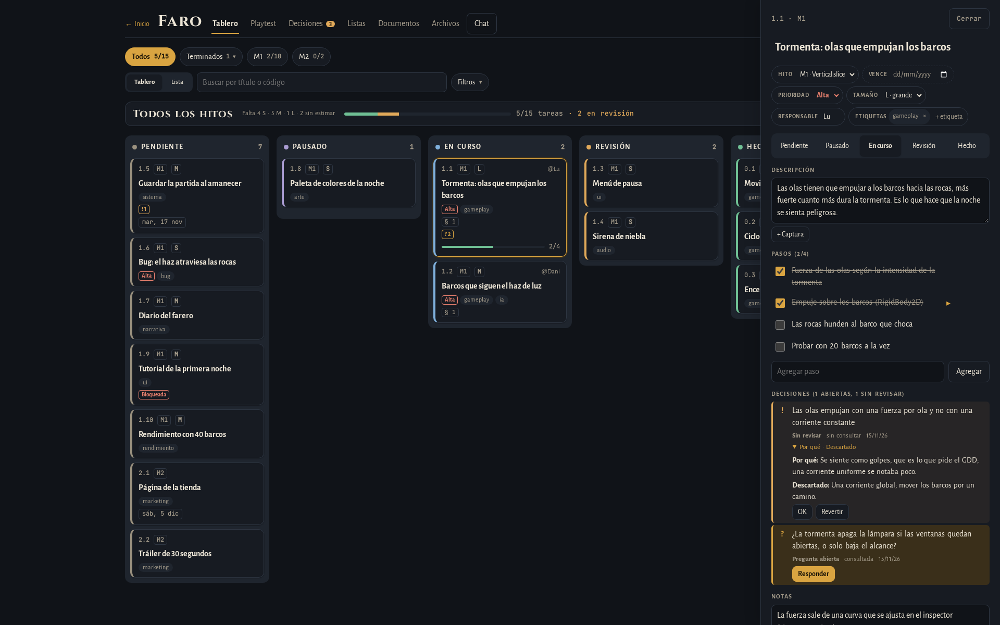
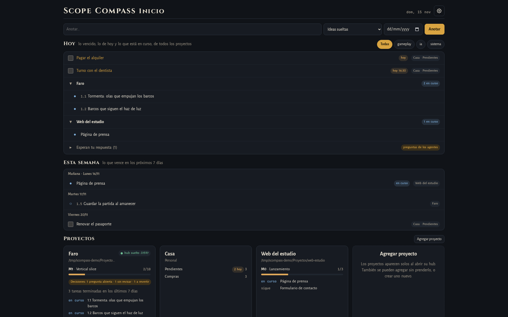
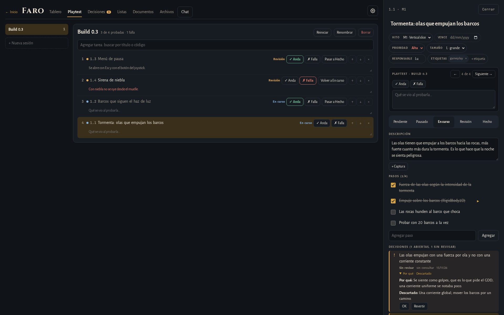
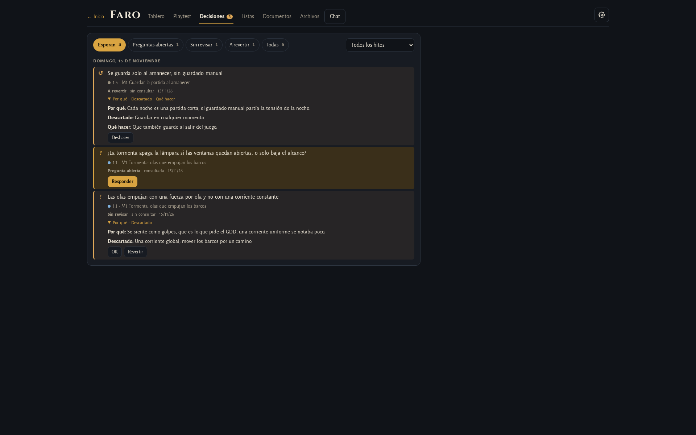
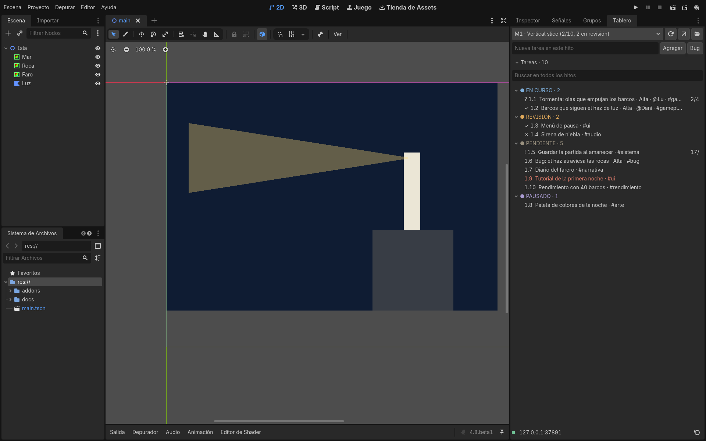
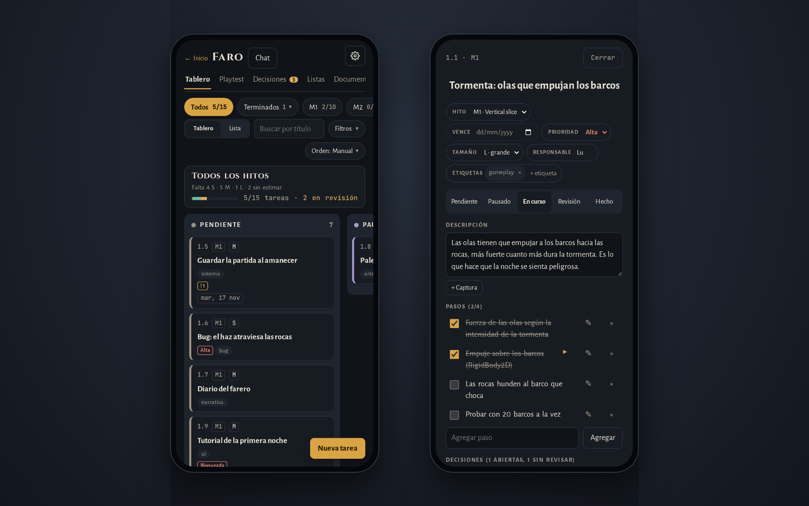

# Scope Compass

[English](README.md) · **Español**

Un organizador de proyectos de videojuegos que guarda los datos en git. Las tareas, los hitos, las listas y los playtests son archivos JSON que se leen, se editan y se versionan solo con git y un editor de texto. Una app local (la CLI `scompass` y un hub con UI web) y un dock para el editor de Godot los hacen cómodos de usar, pero nunca son el único lugar donde viven los datos.

Todo corre en tu equipo: sin cuentas, sin nube, sin telemetría. Lo único que habla con un servicio en línea es el chat, que es opcional y corre el Claude Code instalado en tu equipo con tu propia cuenta.

> **Idioma:** la interfaz (la web, el Inicio, el dock de Godot, la CLI y el MCP) está en castellano y en inglés. La documentación de `docs/` está en castellano.

El tablero en el navegador: cada tarea es un archivo JSON en compass/, y la abierta muestra sus pasos, la prueba y las decisiones del agente.

El Inicio junta todos los proyectos del equipo: lo vencido y lo de hoy, la semana, y las preguntas de los agentes que esperan respuesta.

## Qué hace

- **Tablero por hito.** Cada hito tiene un objetivo y un criterio de "Hecho cuando"; las tareas pasan por Pendiente, Pausado, En curso, Revisión y Hecho. Las tareas tienen pasos, descripción, notas, "Cómo probarlo", fecha límite, etiquetas, prioridad, tamaño, responsable, vínculos con otras tareas, capturas y un historial por tarea sacado de git. También hay una vista de lista con filtros.
- **Documentos (GDD).** Una biblioteca para los documentos markdown del proyecto, con búsqueda, estado de git y referencias estables desde las tareas a secciones de los documentos. La pestaña Archivos muestra los archivos del repo y su estado de git, y las tareas pueden citar los scripts y las escenas que tocan.
- **Playtests.** Las sesiones de playtest ordenan tareas para probarlas y guardan si cada una anduvo o falló, con una nota.
- **Decisiones de los agentes.** Cuando un agente de IA trabaja una tarea, registra lo que decidió solo y las preguntas que necesita que contestes. Se revisan desde el tablero o desde el Inicio.
- **Inicio.** Una página con todos los proyectos del equipo: lo vencido o de hoy, la semana que viene, captura rápida, listas con fecha límite y repetición, y plantillas para empezar un proyecto de juego, personal, vacío o de sala limpia. Sirve el tablero de cada proyecto en un solo puerto, con un ícono en la bandeja.
- **Servidor MCP para Claude Code.** `scompass mcp` ofrece la CLI como herramientas tipadas (listar, ver, crear y mover tareas, tildar pasos, registrar decisiones, buscar en los documentos…), así un agente trabaja el tablero sin comandos de shell. La web además puede abrir un chat con el Claude Code instalado en tu equipo, con tu cuenta.
- **Inglés y castellano.** La CLI, la web, el Inicio, el MCP y el dock siguen el idioma del sistema, del navegador o del editor de Godot; `scompass lang es|en` o el selector de Ajustes eligen uno. Los tableros nuevos (su guía para agentes, el export y la plantilla) salen en el idioma en que se crean.
- **Dock de Godot.** El dock "Tablero" del editor de Godot 4.8 muestra las tareas, abre los scripts y las escenas que cita una tarea y puede levantar el hub. Lee el tablero por su cuenta; para editar necesita el hub.
- **El teléfono en la red de casa.** Con `--lan`, el tablero y el Inicio se abren desde el teléfono en una red de confianza. Si vinculás el teléfono con un QR desde el Inicio, también usa el chat: Claude Code sigue corriendo en tu equipo, con sus perfiles y tu cuenta.

Más capturas:

<table>
<tr>
<td width="50%"> Una sesión de playtest: se prueban las tareas en orden y cada resultado, con su nota, queda en la tarea.</td>
<td width="50%"> Las decisiones que tomó el agente y las preguntas que te hizo, para revisarlas, revertirlas o responderlas en un lugar.</td>
</tr>
<tr>
<td width="50%"> El dock Tablero dentro de Godot: las tareas del hito, conectadas al hub del proyecto, sin salir del editor.</td>
<td width="50%"> En el teléfono, con scompass serve --lan: el mismo tablero, para anotar o tildar desde el sillón.</td>
</tr>
</table>

## Principios

1. **Los datos viven en git; la app es opcional.** Un archivo JSON por hito y por tarea, en una carpeta `compass/`. Si la app se rompe o no está instalada, todo se puede leer y editar a mano.
2. **Local primero.** El hub escucha en `127.0.0.1`. Nada sale de tu equipo salvo que lo subas a un remoto de git.
3. **Personas, agentes y el editor por igual.** Una UI web para las personas, una CLI con `--json` y un servidor MCP para los agentes, y un WebSocket que usa el dock de Godot para estar al día.
4. **Los tableros son tuyos.** Viven en tu carpeta de datos de usuario, no dentro del repo del proyecto, así un juego público puede tener su tablero privado (ver [Dónde viven los tableros](#dónde-viven-los-tableros)).

## Requisitos

- Linux o Windows 10/11, x64. Se desarrolla en Linux y se prueba también en Windows.
- Git.
- Godot 4.8, para el dock.
- Con el binario de la release, nada más: trae su propio Node. Con el paquete de npm (`.tgz`), Node.js 22 o más nuevo.
- Para el chat de la web (opcional): Claude Code instalado y con tu login (correr `claude` una vez), o Antigravity CLI (correr `agy` una vez y elegirlo en Ajustes).

## Instalación

Descargá de la [última release](https://github.com/dannroda/scope-compass/releases/latest):

| Archivo | Qué es |
|---|---|
| `scompass-vX.Y.Z-linux-x64` | La CLI, el hub y la web para Linux, en un solo binario |
| `scompass-vX.Y.Z-windows-x64.exe` | Lo mismo para Windows |
| `scope-compass-addon-vX.Y.Z.zip` | El addon de Godot (el dock) |
| `SHA256SUMS` | Las sumas de los archivos de arriba |

Para comprobar la descarga: `sha256sum -c SHA256SUMS --ignore-missing` (en Windows, `Get-FileHash <archivo>` y comparar).

**Hub y CLI.** Poné el binario donde quieras y abrilo una vez (con doble clic abre el Inicio): anota su ruta, así el addon de Godot y `scompass mcp install` lo encuentran sin el `PATH`. Para escribir `scompass` en una terminal, ponelo en una carpeta del `PATH` con el nombre `scompass` (`scompass.exe` en Windows). En Linux, el [`tools/install.sh`](tools/install.sh) del repo, con `sh install.sh <ruta a scompass-vX.Y.Z-linux-x64>`, lo copia a `~/.local/bin/scompass` y deja **Scope Compass** en el menú de aplicaciones, que levanta el Inicio con ícono en la bandeja. La primera vez que corre cada versión extrae su contenido (unos 30 MB) a `~/.cache/scope-compass/runtime/` (`%LOCALAPPDATA%\scope-compass\runtime\` en Windows).

**Addon de Godot.** Descomprimí el zip en la raíz del proyecto de Godot (crea `addons/scope_compass/`) y activá **Scope Compass** en Proyecto › Configuración del proyecto › Plugins. El dock encuentra el binario por la ruta que anotó o en el `PATH`; si no, indicala en Editor Settings › `scope_compass/scompass_path`.

Los pasos completos, con el paquete de npm y lo propio de Windows, están en [`docs/instalar.md`](docs/instalar.md).

## Primeros pasos

- **Todos tus proyectos:** `scompass home --tray --open` (o **Scope Compass** en el menú, en Linux) abre el Inicio en el navegador. Desde ahí se agregan proyectos que ya existen o se crean nuevos con una plantilla.
- **Un proyecto:** en su carpeta, `scompass init --template juego` crea el tablero (plantillas: `juego`, `personal`, `vacio`, `clean-room`), o **Crear compass/** en el dock de Godot. Después, `scompass serve --open` o **Iniciar hub** en el dock.
- **Desde la terminal:** `scompass list`, `scompass add "Título" --milestone m00`, `scompass move <id> doing`. Con `--json`, la salida es para programas.
- **Claude Code:** registrá el servidor MCP una vez para todos los proyectos con `scompass mcp install` (corre `claude mcp add --scope user` con la ruta entera), e instalá el plugin, cuya skill manda al agente a la guía del tablero (`compass/AGENTS.md`): `/plugin marketplace add dannroda/scope-compass` y después `/plugin install scope-compass@scope-compass`. Sin el plugin, agregá al `AGENTS.md` o `CLAUDE.md` del proyecto: "El tablero de tareas se maneja con scompass; leé compass/AGENTS.md antes de tocarlo."
- **Desde el teléfono:** `scompass home --tray --lan`, o "Activar acceso en la red" en la bandeja. No hay login: cualquiera en esa red puede ver y editar, así que solo en una red de confianza. Ver [SECURITY.md](SECURITY.md).
- **Chat desde el teléfono:** en el Inicio de tu equipo, **Vincular teléfono** muestra un QR (sirve una vez y vence a los 5 minutos). Escanealo, poné un nombre y el tablero muestra el botón **Chat** en el teléfono. Para quitarlo, en el mismo diálogo o con `scompass devices rm <id>`. Anda en la red de casa; fuera de casa, más adelante, por Tailscale.

## Dónde viven los tableros

El tablero de un proyecto siempre se usa como `<proyecto>/compass`, pero por defecto es un enlace (symlink en Linux, junction en Windows) a una carpeta de tus datos de usuario:

- Linux: `~/.local/share/scope-compass/boards/<nombre>/`
- Windows: `%LOCALAPPDATA%\scope-compass\boards\<nombre>\`
- `SCOMPASS_BOARDS` la cambia.

El enlace se excluye en `.git/info/exclude` del proyecto, así que su repo no tiene ningún rastro. Para versionar los tableros, una de dos: hacer de la carpeta de tableros un repo de git antes de crear el primero (un repo para todos, cada tablero en una subcarpeta), o dejar que cada tablero tenga su propio `git init`. Otras opciones:

- `scompass init --in-project` deja el tablero dentro del proyecto, en el repo del proyecto.
- `git submodule add <url> compass` sirve para compartir un tablero con otras personas.
- `scompass board move` saca a la carpeta de tableros un tablero que estaba dentro del proyecto, con su historial; `scompass board link <nombre>` enlaza un tablero clonado en otro equipo.

## Documentación

| Qué | Dónde |
|---|---|
| Instalación y primer uso | [`docs/instalar.md`](docs/instalar.md) |
| Spec completa: formato de los datos, API, CLI, criterios de aceptación | [`docs/spec.md`](docs/spec.md) |
| Decisiones de diseño y por qué | [`docs/decisiones.md`](docs/decisiones.md) |
| Guía para agentes de IA que trabajan un tablero | [`addons/scope_compass/AGENTS.md`](addons/scope_compass/AGENTS.md) |
| El paquete del hub, su estructura y sus tests | [`hub/README.md`](hub/README.md) |
| JSON Schemas de los datos | [`schema/`](schema/) |
| Cambios de cada versión (en inglés) | [`CHANGELOG.md`](CHANGELOG.md) |
| Cómo contribuir (en inglés) | [`CONTRIBUTING.md`](CONTRIBUTING.md) |
| Seguridad (en inglés) | [`SECURITY.md`](SECURITY.md) |

## Licencia

[MIT](LICENSE). El addon de Godot trae su propia copia de la licencia.
