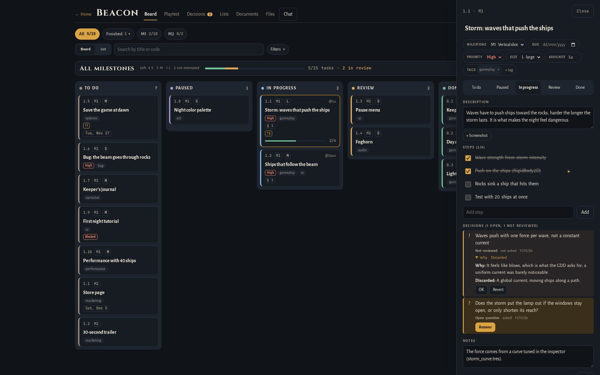
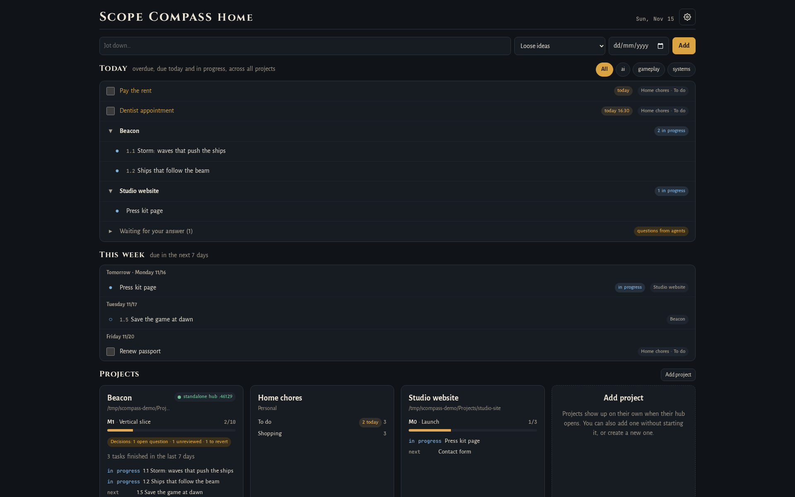
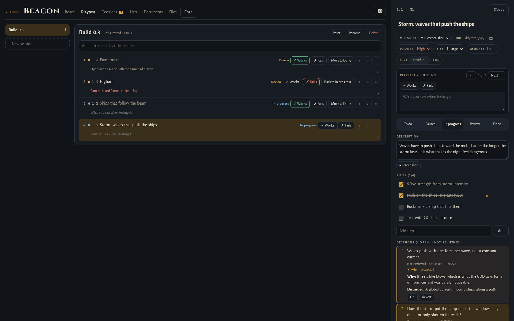
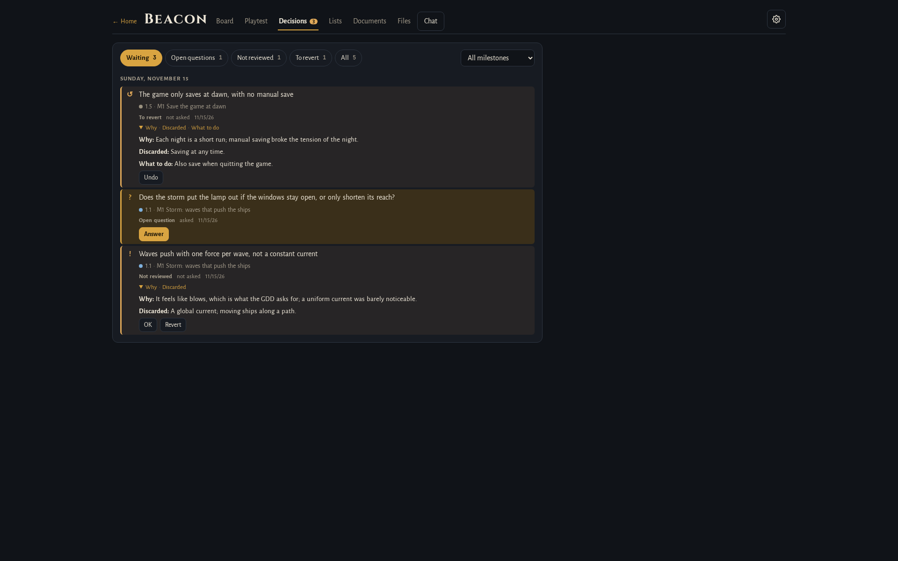
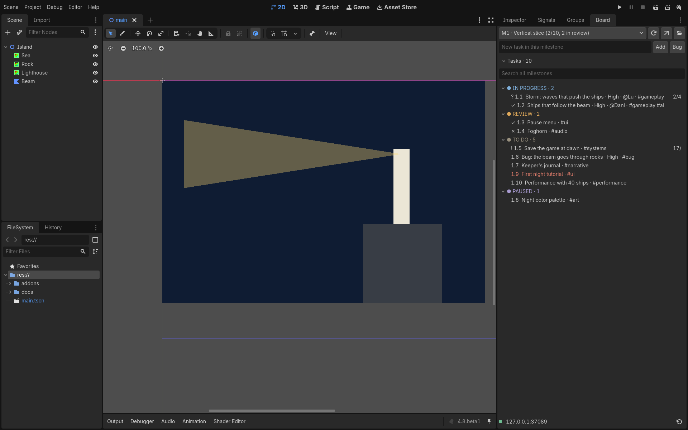
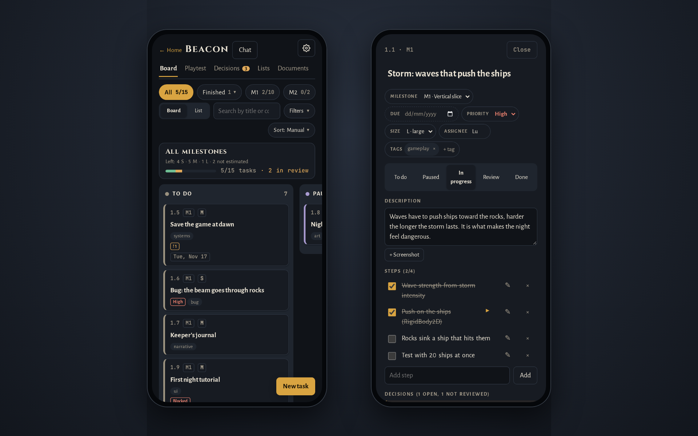

# Scope Compass

**English** · [Español](README.es.md)

A project organizer for video games that keeps its data in git. Tasks, milestones, lists and playtests are plain JSON files you can read, edit and version with nothing but git and a text editor. A local app (the `scompass` CLI, a hub with a web UI) and a dock for the Godot editor make them comfortable to use, but they are never the only place the data lives.

Everything runs on your machine: no accounts, no cloud, no telemetry. The only part that talks to an online service is the optional chat, which runs the Claude Code installed on your machine with your own account.

> **Language:** the interface (web UI, Home, Godot dock, CLI and MCP) is in English and Spanish. The documentation in `docs/` is in Spanish.

The board in the browser: each task is a JSON file in compass/, and the open one shows its steps, its test and the agent's decisions.

Home brings every project on the machine together: what's overdue or due today, the week ahead, and agent questions waiting for an answer.

## What it does

- **Board per milestone.** Each milestone has a goal and a "done when" criterion; tasks move across To do, Paused, In progress, Review and Done. Tasks have steps, a description, notes, "how to test it", due dates, tags, priority, size, assignee, links between tasks, screenshots and a per-task history taken from git. There is also a list view with filters.
- **Documents (GDD).** A library for the project's markdown documents, with search, git status and stable references from tasks to document sections. A Files tab shows the repo's files and their git status, and tasks can point to the scripts and scenes they touch.
- **Playtests.** Playtest sessions put tasks in test order and record whether each one passed or failed, with a note.
- **Agent decisions.** When an AI agent works on a task, it records the choices it made on its own and the questions it needs you to answer. You review them from the board or from the Home page.
- **Home.** One page for every project on the machine: what is overdue or due today, the coming week, quick capture, lists with due dates and repetition, and templates to start a game, personal, empty or clean-room project. It serves every project's board on a single port, with a tray icon.
- **MCP server for Claude Code.** `scompass mcp` exposes the CLI as typed tools (list, show, add and move tasks, check steps, record decisions, search documents…), so an agent works on the board without shell commands. The web UI can also run a chat with the Claude Code installed on your machine, using your own account.
- **Godot dock.** The Board dock inside the Godot 4.8 editor shows the tasks, opens the scripts and scenes a task points to, and can start the hub. It reads the board on its own; editing needs the hub.
- **Phone on your home network.** With `--lan`, the board and Home open from your phone on a trusted network. Link the phone with a QR code from Home and it can use the chat too: Claude Code still runs on your computer, with its profiles and your account.
- **English and Spanish.** The CLI, the web, Home, the MCP and the dock follow your system, browser or Godot editor language; `scompass lang en|es` or the language selector in Settings picks one. New boards (their agent guide, export and template) come in the language you create them in.

More screenshots:

<table>
<tr>
<td width="50%"> A playtest session: tasks are tested in order and each result, with its note, is saved in the task.</td>
<td width="50%"> The decisions the agent made and the questions it asked you, in one place to review, revert or answer.</td>
</tr>
<tr>
<td width="50%"> The Board dock inside Godot: the milestone's tasks, connected to the project's hub, without leaving the editor.</td>
<td width="50%"> On the phone, with scompass serve --lan: the same board, to jot things down or tick steps from the couch.</td>
</tr>
</table>

## Principles

1. **The data lives in git; the app is optional.** One JSON file per milestone and per task, in a `compass/` folder. If the app breaks or is not installed, everything can still be read and edited by hand.
2. **Local first.** The hub listens on `127.0.0.1`. Nothing leaves your machine unless you push it to a git remote.
3. **People, agents and the editor alike.** A web UI for people, a CLI with `--json` and an MCP server for agents, and a WebSocket the Godot dock uses to stay live.
4. **Your boards are yours.** Boards live in your user data folder, not inside the project's repository, so a public game can keep its board private (see [Where the boards live](#where-the-boards-live)).

## Requirements

- Linux or Windows 10/11, x64. Developed on Linux, also tested on Windows.
- Git.
- Godot 4.8, for the dock.
- With the release binary, nothing else: it carries its own Node. With the npm package (`.tgz`), Node.js 22 or newer.
- For the chat in the web UI (optional): Claude Code installed and logged in (run `claude` once), or Antigravity CLI (run `agy` once and pick it in Settings).

## Install

Download the newest release from the [releases page](https://github.com/dannroda/scope-compass/releases) (0.1.0 is a pre-release; after it, pre-releases are beta versions for testing):

| File | What |
|---|---|
| `scompass-vX.Y.Z-linux-x64` | The CLI, hub and web UI for Linux, as one binary |
| `scompass-vX.Y.Z-windows-x64.exe` | The same for Windows |
| `scope-compass-addon-vX.Y.Z.zip` | The Godot addon (the dock) |
| `install.sh`, `install.ps1` | Optional installers for the binary (Linux, Windows) |
| `SHA256SUMS` | Checksums of the files above |

Check the download with `sha256sum -c SHA256SUMS --ignore-missing` (on Windows, `Get-FileHash <file>` and compare).

**Hub and CLI.** Put the binary anywhere and run it once (double-click opens Home): it records its own path, so the Godot addon and `scompass mcp install` find it without the `PATH`. To type `scompass` in a terminal, put it in a folder on your `PATH` named `scompass` (`scompass.exe` on Windows). That is the portable way. To install it instead, use the installer from the release: on Linux, `sh install.sh <path to scompass-vX.Y.Z-linux-x64>` copies it to `~/.local/bin/scompass` and adds **Scope Compass** to the applications menu, which starts Home with a tray icon; on Windows, `powershell -ExecutionPolicy Bypass -File install.ps1 <path to scompass-vX.Y.Z-windows-x64.exe>` copies it to `%LOCALAPPDATA%\Programs\scompass`, adds that folder to your user `PATH` and adds **Scope Compass** to the Start menu, with no admin rights (`install.ps1 -Uninstall` removes it). The first run of each version extracts its contents (about 30 MB) to `~/.cache/scope-compass/runtime/` (`%LOCALAPPDATA%\scope-compass\runtime\` on Windows).

**Godot addon.** Unzip the addon at the root of your Godot project (it creates `addons/scope_compass/`), then enable **Scope Compass** in Project › Project Settings › Plugins. The dock finds the binary from its recorded path, or on the `PATH`; otherwise set it in Editor Settings › `scope_compass/scompass_path`.

**Updating.** `scompass upgrade` downloads the newest release for your platform, checks it against `SHA256SUMS` and replaces the binary (`--check` only tells you whether there is one). Pre-releases only reach the beta channel: `scompass upgrade --channel beta` (back with `--channel stable`), and Editor Settings › `scope_compass/update_channel` for the addon. Home checks once a day and, when there is a new version, offers **Update** at the top of the page and in the tray. Home and the hubs that are already running keep the previous version until they restart (`scompass home restart`, or **Restart Home**). The Godot addon updates itself: the dock offers the new version and restarts the editor (Editor Settings › `scope_compass/check_updates` turns that off).

The full steps, including the npm package and Windows notes, are in [`docs/instalar.md`](docs/instalar.md) (Spanish).

## First steps

- **All your projects:** `scompass home --tray --open` (or **Scope Compass** in the menu on Linux) opens Home in the browser. From there you can add existing projects or create new ones from a template.
- **One project:** in the project's folder, `scompass init --template game` creates a board (templates: `game`, `personal`, `empty`, `clean-room`; also `juego` and `vacio`), or use **Create compass/** in the Godot dock. Then `scompass serve --open`, or **Start hub** in the dock.
- **From the terminal:** `scompass list`, `scompass add "Title" --milestone m00`, `scompass move <id> doing`. Add `--json` for machine-readable output.
- **Claude Code:** register the MCP server once for all projects with `scompass mcp install` (it runs `claude mcp add --scope user` with the full path), and install the plugin, whose skill sends the agent to the board guide (`compass/AGENTS.md`): `/plugin marketplace add dannroda/scope-compass`, then `/plugin install scope-compass@scope-compass`. Without the plugin, add this to the project's `AGENTS.md` or `CLAUDE.md`: "The task board is managed with scompass; read compass/AGENTS.md before touching it."
- **From your phone:** `scompass home --tray --lan`, or "Turn on network access" in the tray. There is no login: anyone on that network can view and edit, so use it only on a network you trust. See [SECURITY.md](SECURITY.md).
- **Chat from your phone:** in Home on your computer, **Link phone** shows a QR code (single use, valid for 5 minutes). Scan it, name the phone, and the board's **Chat** button appears on it. Remove a phone in the same dialog or with `scompass devices rm <id>`. It works on your home network; away from home it will go through Tailscale.

## Where the boards live

A project's board is always reached as `<project>/compass`, but by default that is a link (a symlink on Linux, a junction on Windows) to a folder in your user data directory:

- Linux: `~/.local/share/scope-compass/boards/<name>/`
- Windows: `%LOCALAPPDATA%\scope-compass\boards\<name>\`
- `SCOMPASS_BOARDS` points it elsewhere.

The link is excluded through the project's `.git/info/exclude`, so the project's repository carries no trace of it. To version your boards, either make the boards folder a git repository before creating the first board (one repository for all of them, each board a subfolder) or let each board get its own `git init`. Other options:

- `scompass init --in-project` keeps the board inside the project, in the project's repository.
- `git submodule add <url> compass` shares a board with other people.
- `scompass board move` takes an existing in-project board out to the boards folder, keeping its history; `scompass board link <name>` links a board that already exists (another project's, a standalone one, or one you cloned on another machine) and `scompass board list` shows them. Home (Add project › Link board) and the Godot dock do the same. To change the board of a project that already has one (for example, an old in-project board for the one in your boards repo), use `scompass board link <name> --replace` or the board button in the dock.

## Documentation

| What | Where |
|---|---|
| Installation and first use (Spanish) | [`docs/instalar.md`](docs/instalar.md) |
| Full spec: data format, API, CLI, acceptance criteria (Spanish) | [`docs/spec.md`](docs/spec.md) |
| Design decisions and why (Spanish) | [`docs/decisiones.md`](docs/decisiones.md) |
| Guide for AI agents working on a board (Spanish) | [`addons/scope_compass/AGENTS.md`](addons/scope_compass/AGENTS.md) |
| The hub package, its layout and tests (Spanish) | [`hub/README.md`](hub/README.md) |
| JSON Schemas of the data | [`schema/`](schema/) |
| Changes per release | [`CHANGELOG.md`](CHANGELOG.md) |
| Contributing | [`CONTRIBUTING.md`](CONTRIBUTING.md) |
| Security | [`SECURITY.md`](SECURITY.md) |

## License

[MIT](LICENSE). The Godot addon carries its own copy of the license.
